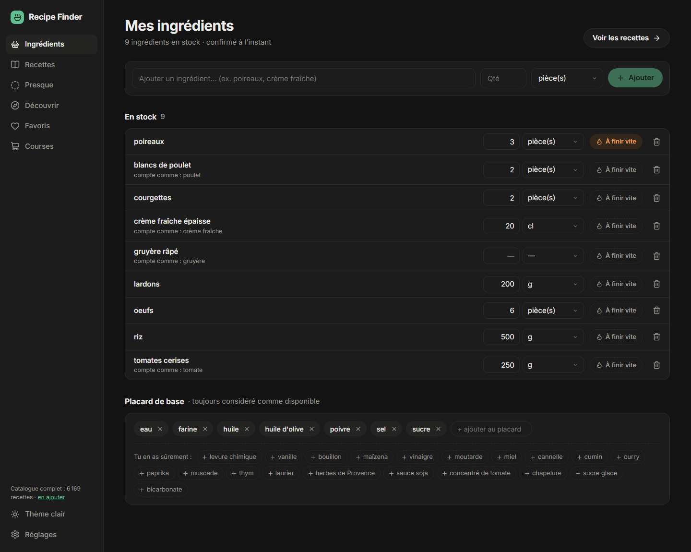
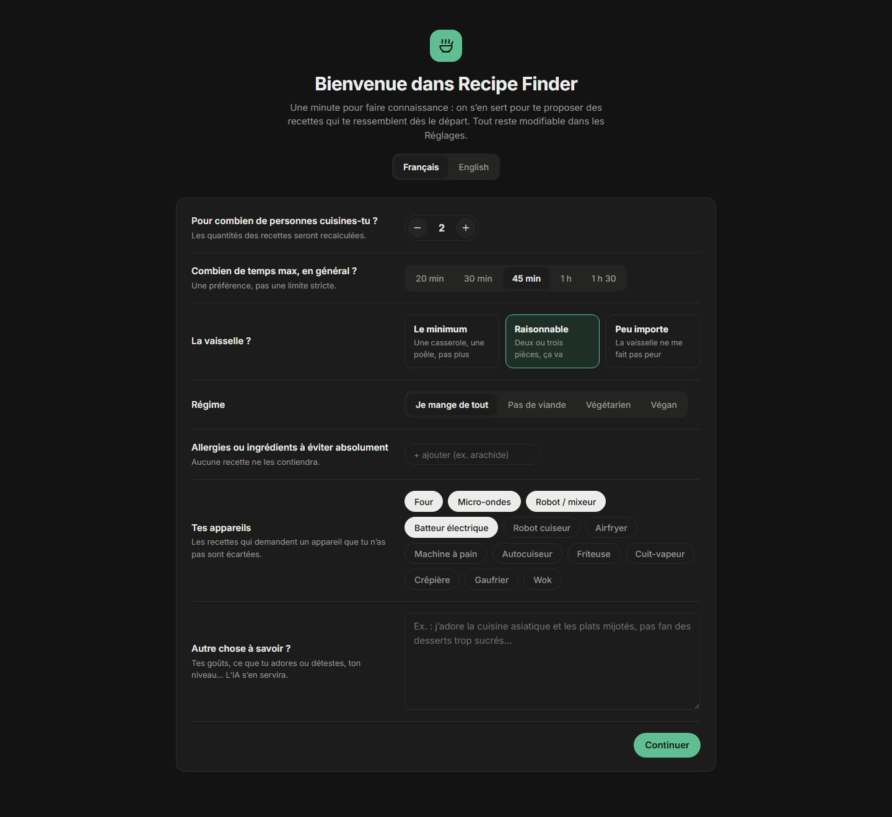

# Recipe Finder

**Qu'est-ce qu'on mange ce soir, avec ce qu'il y a dans le frigo ?**

Recipe Finder est une app perso, 100 % locale, qui propose de **vraies recettes** (issues de Marmiton, pas inventées par une IA) faisables avec les ingrédients que tu as chez toi, classées selon tes goûts. Une IA sert d'assistant (ton abonnement Claude, ou un modèle gratuit qui tourne sur ton PC) : elle tient ton profil à jour et répond à tes questions sur une recette, sans être appelée à chaque clic.

  
  

## Fonctionnalités

- **Mes ingrédients** : ton stock avec quantités, autocomplétion, badge « à finir vite » pour écouler ce qui va se perdre, et un placard de base (sel, huile, farine…) toujours considéré comme disponible.
- **Recettes** : des recettes faisables **sans rien acheter**, 10 par 10, filtrables par type (plat, entrée, accompagnement, dessert, apéro, petit-déj., boisson, sauce) et par durée. La liste se met à jour dès que ton stock change.
- **Presque** : les recettes où il te manque 1 à 3 ingrédients, de préférence faciles à trouver.
- **Like / dislike** : un like range la recette dans tes favoris (copie locale complète, même si la page disparaît) ; un dislike l'écarte. Tu peux aussi rejeter un ingrédient précis d'un clic.
- **Fiche recette** : quantités recalculées pour ton nombre de personnes, temps, ustensiles, nombre de pièces à laver, étapes, lien vers la source, et un **chat avec l'IA** (Claude ou le modèle local) qui connaît déjà la recette, ton stock et tes goûts.
- **Profil** : un questionnaire de départ (personnes, temps, vaisselle, régime, allergies, appareils, goûts), puis un profil que l'IA affine à partir de tes likes, rejets et questions. Tes aversions fermes (« rien qui vienne de la mer ») deviennent des exclusions strictes.
- **Pour qui je cuisine** : ajoute les membres de ta famille, chacun avec son régime, ses allergies et ce qu'il n'aime pas. Au moment de choisir, tu coches qui mange : les exclusions de chacun s'appliquent et les portions s'adaptent.
- **Allergies et régimes** : exclusions strictes par famille (gluten, lactose, fruits à coque, poisson…), vérifiées sur les ingrédients mais aussi sur le texte complet des recettes.
- **Français ou anglais** : toute l'interface existe dans les deux langues. En anglais, les recettes (en français sur le site) sont traduites par l'IA la première fois qu'elles s'affichent, unités comprises (c. à soupe → tbsp), puis gardées sur ton PC ; tu peux taper tes ingrédients en anglais.
- **Catalogue** : 5 000 recettes bien notées au premier lancement (environ 5 h d'import, l'app est utilisable dès les premières centaines), extensibles depuis les Réglages.

> **Claude, modèle local ou les deux ?** Toutes les fonctionnalités marchent avec l'un ou l'autre. La différence est la qualité : avec le **modèle local seul**, les réponses du chat sont plus simples et parfois moins sûres (substitutions, conseils de cuisson), et le profil saisit moins finement les nuances de tes notes. Avec **ton abonnement Claude**, le chat et le profil sont nettement meilleurs ; le modèle local, s'il est installé, se charge alors des tâches de fond pour ménager ton abonnement. Sans aucune IA, tout fonctionne sauf le chat, la mise à jour du profil, la reconnaissance des nouveaux ingrédients et la traduction en anglais.

## Comment ça marche

- **Catalogue local** : les recettes sont lues depuis les données structurées (schema.org/Recipe) des pages Marmiton, puis stockées dans une base SQLite locale. Chaque ligne d'ingrédient (« 2 gousses d'ail hachées ») est ramenée à un ingrédient de base (« ail ») par un analyseur local ; seuls les termes inconnus sont envoyés à l'IA, par lots, et le résultat est mis en cache.
- **Classement local, sans IA** : charger ou recalculer une liste ne coûte aucun appel. Le score combine ton stock, ce qui est « à finir vite », la note de la recette (pondérée par le nombre d'avis), la ressemblance avec ce que tu aimes ou rejettes, tes préférences, et ~30 % d'exploration pour ne pas tourner en rond.
- **L'IA, avec parcimonie et sans clé API** : uniquement pour le chat, la mise à jour du profil (dès 10 nouveaux signaux, au plus une fois par heure, ou à la demande) et la reconnaissance des nouveaux ingrédients. Deux fournisseurs, utilisables ensemble :
  - **ton abonnement Claude** (Pro, Max…), via Claude Code : meilleure qualité, utilisé en priorité pour le chat et le profil ;
  - **un modèle local gratuit** (Gemma 3 via [Ollama](https://ollama.com)) : privé, hors ligne, utilisé en priorité pour les tâches de fond. Il demande une carte graphique correcte ; une version légère existe pour les PC plus modestes.

  Si l'un manque ou échoue, l'autre prend le relais. Les appels sont mis en file pour ne jamais partir en rafale.

## Installer

Sur Windows 10 ou 11, sans rien d'autre à installer au préalable :

1. Télécharge le projet (bouton vert **Code → Download ZIP**) et décompresse-le où tu veux.
2. Double-clique sur **`install.cmd`**.

Le script installe Node.js si besoin, prépare l'app, crée le raccourci **Recipe Finder** sur le bureau et ouvre l'app. Ensuite, le raccourci suffit : il démarre l'app en arrière-plan et l'ouvre dans ton navigateur par défaut (en fenêtre dédiée avec Chrome, Edge, Brave ou Vivaldi).

Au premier lancement :

1. un court questionnaire (personnes, temps, vaisselle, régime, allergies, appareils, goûts) ;
2. **Connecter une IA**, facultatif, un clic par option :
   - **« Connecter mon abonnement Claude »** : l'app installe Claude Code si besoin et ouvre la connexion à ton compte dans le navigateur (abonnement Pro, Max, Team ou Enterprise ; le plan gratuit ne donne pas accès à Claude Code) ;
   - **« Installer le modèle local »** : l'app installe Ollama et télécharge le modèle (environ 8 Go), avec la progression affichée.

L'import du catalogue démarre aussitôt ; les premières recettes arrivent en quelques minutes et l'app reste utilisable pendant l'import. Sans IA, l'app fonctionne aussi : seuls le chat, la mise à jour du profil et la reconnaissance des nouveaux ingrédients sont en pause.

## Données et vie privée

Tout reste sur ton PC, dans le dossier de l'app. Réglages → « Exporter mes données » produit un fichier JSON avec ton stock, tes favoris, tes rejets, tes préférences, ton profil et tes conversations. Avec le modèle local, rien ne sort de ton PC. Avec Claude, seul ce qui est nécessaire à chaque appel (la recette, ton stock, ton profil) est envoyé, via ton propre compte.

## Sources

Les recettes, photos et textes appartiennent à [Marmiton](https://www.marmiton.org) et à leurs auteurs ; chaque fiche renvoie vers la page d'origine. Ce projet est un outil **personnel** : il ne lit que les pages autorisées par le `robots.txt` du site, à raison d'une page toutes les 2,5 secondes, et ne redistribue aucun contenu (la base reste locale). Merci de respecter ces conditions si tu le réutilises.

---

Pour contribuer ou modifier l'app : [docs/DEVELOPPEMENT.md](docs/DEVELOPPEMENT.md).
