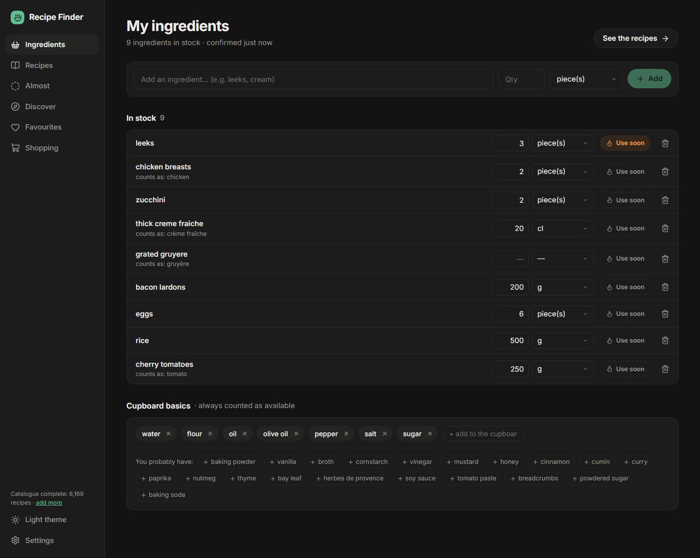
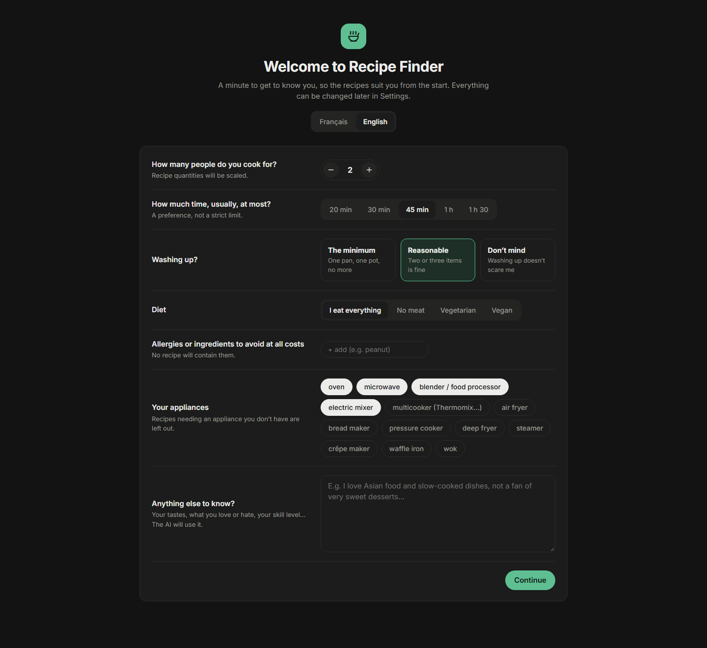

# Recipe Finder

**Qu'est-ce qu'on mange ce soir, avec ce qu'il y a dans le frigo ?**

*English version [below](#english).*

Recipe Finder est une app perso, 100 % locale, qui propose de **vraies recettes** (issues de Marmiton, pas inventées par une IA) faisables avec les ingrédients que tu as chez toi, classées selon tes goûts. Une IA sert d'assistant (ton abonnement Claude, ou un modèle gratuit qui tourne sur ton PC) : elle tient ton profil à jour et répond à tes questions sur une recette, sans être appelée à chaque clic.

  
  

## Fonctionnalités

- **Mes ingrédients** : ton stock avec quantités, autocomplétion, badge « à finir vite » pour écouler ce qui va se perdre, et un placard de base (sel, huile, farine…) toujours considéré comme disponible.
- **Recettes** : des recettes faisables **sans rien acheter**, 20 par 20, filtrables par type (plat, entrée, accompagnement, dessert, apéro, petit-déj., boisson, sauce) et par durée. La liste se met à jour dès que ton stock change.
- **Presque** : les recettes où il te manque 1 à 3 ingrédients, de préférence faciles à trouver.
- **Découvrir** : des recettes qui devraient te plaire d'après tes goûts (profil, likes), même s'il te manque plusieurs ingrédients.
- **« Je la fais » et Courses** : sur une recette, un bouton calcule ce qu'il te manque pour le nombre de personnes choisi (ingrédient absent, ou quantité insuffisante, unités converties) et l'ajoute à l'onglet **Courses**. Un article acheté est rangé dans ton stock d'un clic.
- **Like / dislike** : un like range la recette dans tes favoris (copie locale complète, même si la page disparaît) ; un dislike l'écarte. Tu peux aussi rejeter un ingrédient précis d'un clic.
- **Fiche recette** : quantités recalculées pour ton nombre de personnes, temps, ustensiles, nombre de pièces à laver, étapes, lien vers la source, et un **chat avec l'IA** (Claude ou le modèle local) qui connaît déjà la recette, ton stock et tes goûts.
- **Profil** : un questionnaire de départ (personnes, temps, vaisselle, régime, allergies, appareils, goûts), puis un profil que l'IA affine à partir de tes likes, rejets et questions. Tes aversions fermes (« rien qui vienne de la mer ») deviennent des exclusions strictes.
- **Pour qui je cuisine** : ajoute les membres de ta famille, chacun avec son régime, ses allergies et ce qu'il n'aime pas. Au moment de choisir, tu coches qui mange : les exclusions de chacun s'appliquent et les portions s'adaptent.
- **Allergies et régimes** : exclusions strictes par famille (gluten, lactose, fruits à coque, poisson…), vérifiées sur les ingrédients mais aussi sur le texte complet des recettes.
- **Français ou anglais** : l'app est pensée pour le français, puisque les recettes viennent de Marmiton, en français. Elle fonctionne aussi en anglais (interface entière, saisie des ingrédients en anglais), mais les recettes doivent d'abord être traduites par l'IA, unités comprises (c. à soupe → tbsp) : quelques secondes pour les noms, 15 à 30 s pour une recette la première fois qu'elle s'ouvre, puis c'est instantané (la traduction est gardée sur ton PC). Sans IA, les recettes restent en français.
- **Catalogue** : 5 000 recettes bien notées au premier lancement (environ 3 h d'import, l'app est utilisable dès les premières centaines), extensibles depuis les Réglages. Tu peux y faire passer certains types en priorité (plats et accompagnements, par exemple) : ce n'est pas un filtre, mais leur part dans l'import passe d'environ 4 recettes sur 10 à 8 sur 10, puis l'import continue avec les autres types.

> **Claude, modèle local ou les deux ?** Toutes les fonctionnalités marchent avec l'un ou l'autre. La différence est la qualité : avec le **modèle local seul**, les réponses du chat sont plus simples et parfois moins sûres (substitutions, conseils de cuisson), et le profil saisit moins finement les nuances de tes notes. Avec **ton abonnement Claude**, le chat et le profil sont nettement meilleurs ; le modèle local, s'il est installé, se charge alors des tâches de fond pour ménager ton abonnement. Sans aucune IA, tout fonctionne sauf le chat, la mise à jour du profil, la reconnaissance des nouveaux ingrédients et la traduction en anglais.

## Comment ça marche

- **Catalogue local** : les recettes sont lues depuis les données structurées (schema.org/Recipe) des pages Marmiton, puis stockées dans une base SQLite locale. Chaque ligne d'ingrédient (« 2 gousses d'ail hachées ») est ramenée à un ingrédient de base (« ail ») par un analyseur local ; seuls les termes inconnus sont envoyés à l'IA, par lots, et le résultat est mis en cache.
- **Classement local, sans IA** : charger ou recalculer une liste ne coûte aucun appel. Le score combine ton stock, ce qui est « à finir vite », la note de la recette (pondérée par le nombre d'avis), la ressemblance avec ce que tu aimes ou rejettes, tes préférences, et ~30 % d'exploration pour ne pas tourner en rond.
- **L'IA, avec parcimonie et sans clé API** : uniquement pour le chat, la mise à jour du profil (dès 10 nouveaux signaux, au plus une fois par heure, ou à la demande), la reconnaissance des nouveaux ingrédients et la traduction. Deux fournisseurs, utilisables ensemble :
  - **ton abonnement Claude** (Pro, Max…), via Claude Code : meilleure qualité, utilisé en priorité pour le chat et le profil ;
  - **un modèle local gratuit** (Gemma 3 via [Ollama](https://ollama.com)) : privé, hors ligne, utilisé en priorité pour les tâches de fond. Il demande une carte graphique correcte ; une version légère existe pour les PC plus modestes. Gemma est fourni par Google selon ses [conditions d'utilisation](https://ai.google.dev/gemma/terms), et Claude Code par Anthropic selon les siennes : tu les acceptes en les installant.

  Si l'un manque ou échoue, l'autre prend le relais. Les appels sont mis en file pour ne jamais partir en rafale.

## Installer

Sur Windows 10 ou 11, sans rien d'autre à installer au préalable :

1. Télécharge le projet (bouton vert **Code → Download ZIP**) et décompresse-le où tu veux.
2. Double-clique sur **`install.cmd`**.

Le script installe Node.js et Git si besoin, prépare l'app, crée le raccourci **Recipe Finder** (bureau et menu Démarrer) et ouvre l'app. Ensuite, le raccourci suffit : il démarre l'app en arrière-plan et l'ouvre dans ton navigateur par défaut (en fenêtre dédiée avec Chrome, Edge, Brave ou Vivaldi, qui retrouve sa taille et sa position).

**Mises à jour** : l'app vérifie au lancement (puis toutes les 6 h) si une nouvelle version est publiée ici. Si oui, Réglages → « Mises à jour » montre les nouveautés et un bouton **Mettre à jour** : l'app télécharge la nouvelle version, se prépare et redémarre toute seule. Tes données ne sont jamais touchées.

Au premier lancement :

1. le choix de la langue (français ou anglais) et un court questionnaire (personnes, temps, vaisselle, régime, allergies, appareils, goûts) ;
2. **Connecter une IA**, facultatif, un clic par option :
   - **« Connecter mon abonnement Claude »** : l'app installe Claude Code si besoin et ouvre la connexion à ton compte dans le navigateur (abonnement Pro, Max, Team ou Enterprise ; le plan gratuit ne donne pas accès à Claude Code) ;
   - **« Installer le modèle local »** : l'app installe Ollama et télécharge le modèle (environ 8 Go), avec la progression affichée.

L'import du catalogue démarre aussitôt ; les premières recettes arrivent en quelques minutes et l'app reste utilisable pendant l'import. Sans IA, l'app fonctionne aussi : seuls le chat, la mise à jour du profil, la reconnaissance des nouveaux ingrédients et la traduction sont en pause.

## Données et vie privée

Tout reste sur ton PC, dans le dossier de l'app. Réglages → « Exporter mes données » produit un fichier JSON avec ton stock, tes favoris, tes rejets, tes préférences, ton profil et tes conversations. Avec le modèle local, rien ne sort de ton PC. Avec Claude, seul ce qui est nécessaire à chaque appel (la recette, ton stock, ton profil) est envoyé, via ton propre compte. Le serveur local de l'app ne répond qu'à l'app elle-même : les autres sites ouverts dans ton navigateur ne peuvent ni lire ni modifier tes données.

## Sources

Les recettes, photos et textes appartiennent à [Marmiton](https://www.marmiton.org) et à leurs auteurs ; chaque fiche renvoie vers la page d'origine. Recipe Finder est un projet indépendant, sans lien avec Marmiton ni Reworld Media.

Les [conditions d'utilisation de Marmiton](https://www.marmiton.org/sp/aide/conditions-generales-utilisation.html) permettent d'extraire des données de sa base **pour un usage privé** et interdisent tout usage commercial. Recipe Finder s'y tient : chacun importe les recettes pour lui seul, sur son PC, et rien n'est redistribué (ce dépôt ne contient aucune recette ni photo). L'app ne lit que les pages autorisées par le `robots.txt` du site, à raison d'une page par seconde au plus, et s'identifie honnêtement. Si tu réutilises ce code, garde cet usage personnel et non commercial. Pour toute demande concernant ces contenus, ouvre une *issue* sur ce dépôt.

## Licence

Le code est sous licence [MIT](LICENSE) : tu peux le réutiliser, le modifier et le redistribuer librement, en gardant la mention de copyright. Le logo reprend l'icône « Soup » de [Lucide](https://lucide.dev) (licence ISC). Cette licence couvre uniquement le code de l'app, pas les recettes ni les photos, qui restent la propriété de Marmiton et de leurs auteurs.

---

Pour contribuer ou modifier l'app : [docs/DEVELOPPEMENT.md](docs/DEVELOPPEMENT.md).

---

# Recipe Finder (English)

> **Good to know:** Recipe Finder is designed for French. Recipes come from Marmiton, a French site, so in English they must first be translated by the AI, which takes a little time the first time each recipe is shown (see below).

**What's for dinner tonight, with what's in the fridge?**

Recipe Finder is a personal, 100% local app that suggests **real recipes** (from Marmiton, the French recipe site, not invented by an AI) that you can cook with the ingredients you already have, ranked by your tastes. An AI acts as an assistant (your Claude subscription, or a free model running on your PC): it keeps your profile up to date and answers your questions about a recipe, without being called on every click.

  
  

## Features

- **My ingredients**: your pantry with quantities, autocomplete, a “use soon” badge to finish what would go to waste, and cupboard basics (salt, oil, flour…) always counted as available.
- **Recipes**: recipes you can make **without buying anything**, 20 at a time, filterable by type (main, starter, side, dessert, appetiser, breakfast, drink, sauce) and by time. The list updates as soon as your pantry changes.
- **Almost**: recipes where you're missing 1 to 3 ingredients, preferably easy to find.
- **Discover**: recipes you should like based on your tastes (profile, likes), even if several ingredients are missing.
- **“I'll make it” and Shopping**: on a recipe, one button works out what you're missing for the number of people you picked (missing ingredient, or not enough of it, units converted) and adds it to the **Shopping** tab. A bought item goes into your pantry in one click.
- **Like / dislike**: a like saves the recipe to your favourites (a full local copy, even if the page disappears); a dislike hides it. You can also reject a specific ingredient in one click.
- **Recipe page**: quantities scaled to the number of people, times, equipment, number of items to wash, steps, link to the source, and a **chat with the AI** (Claude or the local model) that already knows the recipe, your pantry and your tastes.
- **Profile**: a short welcome questionnaire (people, time, washing up, diet, allergies, appliances, tastes), then a profile the AI refines from your likes, rejections and questions. Firm dislikes (“nothing from the sea”) become strict exclusions.
- **Who I cook for**: add your family members, each with their own diet, allergies and dislikes. When choosing, you tick who is eating: everyone's exclusions apply and portions adjust.
- **Allergies and diets**: strict exclusions by family (gluten, lactose, nuts, fish…), checked against the ingredients and the full recipe text.
- **French or English**: the app is designed for French, since recipes come from Marmiton, in French. It also works in English (full interface, ingredients typed in English), but recipes must first be translated by the AI, units included (c. à soupe → tbsp): a few seconds for names, 15 to 30 s for a recipe the first time it opens, then it's instant (the translation is kept on your PC). Without an AI, recipes stay in French.
- **Catalogue**: 5,000 well-rated recipes on first launch (about 3 hours of import; the app is usable after the first few hundred), expandable from Settings. You can put some types first (mains and sides, for instance): it isn't a filter, but their share of the import goes from about 4 in 10 recipes to 8 in 10, then the import carries on with the other types.

> **Claude, local model or both?** Every feature works with either. The difference is quality: with the **local model alone**, chat answers are simpler and sometimes less reliable (substitutions, cooking advice), and the profile captures the nuances of your notes less finely. With **your Claude subscription**, chat and profile are clearly better; the local model, if installed, then handles background tasks to spare your subscription. Without any AI, everything works except chat, profile updates, recognising new ingredients and English translation.

## How it works

- **Local catalogue**: recipes are read from the structured data (schema.org/Recipe) of Marmiton pages, then stored in a local SQLite database. Each ingredient line (“2 gousses d'ail hachées”) is reduced to a base ingredient (“ail”, garlic) by a local parser; only unknown terms are sent to the AI, in batches, and the result is cached.
- **Local ranking, no AI**: loading or recomputing a list costs no AI call. The score combines your pantry, what needs using soon, the recipe rating (weighted by number of reviews), similarity to what you like or reject, your preferences, and ~30% exploration so suggestions don't go round in circles.
- **AI, sparingly and without an API key**: only for chat, profile updates (from 10 new signals, at most once an hour, or on demand), recognising new ingredients and translation. Two providers, usable together:
  - **your Claude subscription** (Pro, Max…), via Claude Code: best quality, used first for chat and profile;
  - **a free local model** (Gemma 3 via [Ollama](https://ollama.com)): private, offline, used first for background tasks. It needs a decent graphics card; a lighter version exists for more modest PCs. Gemma is provided by Google under its [terms of use](https://ai.google.dev/gemma/terms), and Claude Code by Anthropic under its own: you accept them when installing them.

  If one is missing or fails, the other takes over. Calls are queued so they never go out in bursts.

## Install

On Windows 10 or 11, with nothing to install beforehand:

1. Download the project (green **Code → Download ZIP** button) and unzip it wherever you like.
2. Double-click **`install.cmd`**.

The script installs Node.js and Git if needed, sets up the app, creates the **Recipe Finder** shortcut on the desktop and opens the app. After that, the shortcut is all you need: it starts the app in the background and opens it in your default browser (in its own window with Chrome, Edge, Brave or Vivaldi, which keeps its size and position).

**Updates**: the app checks at launch (then every 6 hours) whether a new version has been published here. If so, Settings → “Updates” shows what's new and an **Update** button: the app downloads the new version, gets ready and restarts by itself. Your data is never touched.

On first launch:

1. pick your language and answer a short questionnaire (people, time, washing up, diet, allergies, appliances, tastes);
2. **Connect an AI**, optional, one click per option:
   - **“Connect my Claude subscription”**: the app installs Claude Code if needed and opens the sign-in to your account in the browser (Pro, Max, Team or Enterprise subscription; the free plan does not include Claude Code);
   - **“Install the local model”**: the app installs Ollama and downloads the model (about 8 GB), with progress shown.

The catalogue import starts right away; the first recipes arrive within minutes and the app stays usable during the import. Without AI the app works too: only chat, profile updates, recognising new ingredients and translation are paused.

## Data and privacy

Everything stays on your PC, in the app folder. Settings → “Export my data” produces a JSON file with your pantry, favourites, rejections, preferences, profile and conversations. With the local model, nothing leaves your PC. With Claude, only what each call needs (the recipe, your pantry, your profile) is sent, through your own account. The app's local server only answers the app itself: other websites open in your browser cannot read or change your data.

## Sources

Recipes, photos and texts belong to [Marmiton](https://www.marmiton.org) and their authors; every recipe page links back to the original. Recipe Finder is an independent project, not affiliated with Marmiton or Reworld Media.

[Marmiton's terms of use](https://www.marmiton.org/sp/aide/conditions-generales-utilisation.html) allow extracting data from its database **for private use** and forbid any commercial use. Recipe Finder sticks to that: everyone imports recipes for themselves only, on their own PC, and nothing is redistributed (this repository contains no recipes or photos). The app only reads pages allowed by the site's `robots.txt`, at most one page per second, and identifies itself honestly. If you reuse this code, keep this use personal and non-commercial. For any request about this content, open an *issue* on this repository.

## License

The code is released under the [MIT License](LICENSE): you may reuse, modify and redistribute it freely, keeping the copyright notice. The logo uses Lucide's “Soup” icon ([Lucide](https://lucide.dev), ISC license). This license covers the app's code only, not the recipes or photos, which remain the property of Marmiton and their authors.

---

To contribute or modify the app: [docs/DEVELOPPEMENT.md](docs/DEVELOPPEMENT.md#development).
